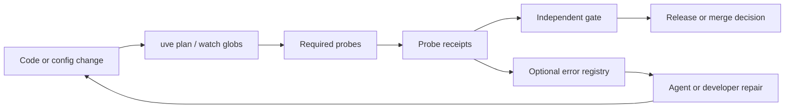

# UVE project adoption plan

**Plan ID:** `uve-project-adoption.v1`  
**Last updated:** 2026-11-06  
**Audience:** Any team cloning [UVE](https://github.com/Zelaox/uve) and binding a real application or library.

This plan is the **single checklist** for going from the shipped command demo to manifest-driven probes, optional Android acceptance, agent workflows, error registries, and user-flow invariants. Replace every `{PLACEHOLDER}` with values for **your** repository. Do not copy another product’s package name, selectors, or receipts.

---

## Mission

1. **Bind** a workspace so every probe records **which bytes** were tested.
2. **Run** required probes through the real CLI; keep immutable **probe receipts**.
3. **Evaluate** gates with an **independently assigned** evaluator (not the repair author under another label).
4. **Diagnose** failures through receipts first, then an optional **project-owned error registry**.
5. **Extend** with **user flows** when probes alone cannot prove UI/backend parity.

Closed loop:



---

## Non-negotiable verification rules

These apply in every phase:

| Rule | Meaning |
|------|---------|
| **Fresh evidence** | After source, manifest, binding, or delivery changes, re-run affected probes on the **final** candidate. Old passing receipts do not certify new bytes. |
| **Receipt is authoritative** | Verdict, `failure_class`, fault rule, and probe ID in the receipt override informal logs or screenshots. |
| **Separate tiers** | Engine self-check, Workstation V1/V2/V3, and **application acceptance** are different gates. Report each honestly. |
| **not_verified is valid** | Missing profile, device, evaluator, or binding → say **implemented; UVE not_verified**, not “verified”. |
| **No hardcoded machine state in product code** | Serial, port, package, post IDs, and expected counts belong in **manifests**, env vars named in manifests, or operator-local fixture files — not scattered literals. |
| **Registry guides; it does not approve** | Lookup suggests next steps; only gate evaluation approves. |

---

## Phase 0 — Engine checkout (same for everyone)

From a machine with Git and Python 3.11+:

```sh
git clone https://github.com/Zelaox/uve.git
cd uve
python -B -m examples.command_regression
```

Inspect receipts under `logs/uve/probes/`. Optional: `python -m pip install -e ".[dev]"` and `python -B -m pytest -q`.

**Done when:** You understand probe ID → receipt JSON → gate evaluate flow ([`examples/README.md`](../../../examples/README.md)).

---

## Phase 1 — Command-only project (no Android)

Use this for libraries, CLIs, or backends before any emulator exists.

### 1.1 Create project manifests (in UVE checkout or your repo)

Copy and rename:

| Template | Your file (example) |
|----------|---------------------|
| [`examples/project/profile.json`](../../../examples/project/profile.json) | `config/uve/profiles/{PROJECT_ID}_development.json` |
| [`examples/project/root.json`](../../../examples/project/root.json) | `config/uve/targets/{PROJECT_ID}/project_root.json` |
| [`examples/project/command.json`](../../../examples/project/command.json) | `config/uve/targets/{PROJECT_ID}/command_check.json` |

Set `{PROJECT_ID}` (e.g. `my_app`). Point `project_root_ref` at a manifest that binds `{YOUR_WORKSPACE}` via an environment variable (see `root.json` pattern: `UVE_PROJECT_ROOT`).

### 1.2 Watch the right files

In the profile `identity.watch_globs`, include every path that can change behavior: source, tests, build config, and **UVE manifests themselves**. Exclude generated artifacts (`node_modules`, `build`, `.venv`, etc.).

### 1.3 Declare the command probe

In `command.json`:

- `argv`: executable + args as a JSON array (no shell string).
- `timeout_seconds`, `expected_returncode`, optional `expected_stdout`.
- Use `{python}` / `{workspace_root}` substitutions where the engine supports them.

### 1.4 Run and gate

```sh
export UVE_PROJECT_ROOT="/absolute/path/to/your/repo"
uveProfile="config/uve/profiles/{PROJECT_ID}_development.json"
uveActor="YOUR_ACTUAL_ACTOR"

python -B -m agent_training.uve.cli probe run \
  --profile "$uveProfile" --probe command_check --repair-actor-ref "$uveActor"

python -B -m agent_training.uve.cli gate evaluate \
  --profile "$uveProfile" --gate command_check \
  --probe-run-id PROBE_RUN_ID \
  --evaluator-ref ASSIGNED_EVALUATOR \
  --repair-actor-ref "$uveActor"
```

**Done when:** A deliberate regression produces `failed`, fix restores `passed`, and gate `approved` uses **new** probe IDs.

---

## Phase 2 — Optional Workstation / Android runtime

Skip if you only need command probes. If you use **Emulator Workstation** (or any host that runs the UVE worker):

1. Read the host’s UVE docs and `training_pipeline/config/uve/uve_workstation_runtime.json` for **V1/V2/V3** probe and gate mapping ([`docs/engine.md`](../../engine.md)).
2. Read the host **`verification/context.json`** (serial, package, Metro port, project root). **Never guess** ADB serial or guest package from an old receipt.
3. Bind pipeline root via a manifest in **your app repo**, e.g. `config/emulator-workstation/uve-emulator-pipeline-root.json` with env key `UVE_EMULATOR_PIPELINE_ROOT` pointing at the active worker’s `training_pipeline`.

Start from [`config/uve/profiles/android_example_development.json`](../../../config/uve/profiles/android_example_development.json) and targets under `config/uve/targets/android_example/`. Copy, set `UVE_ANDROID_EXAMPLE_ROOT`, bind real serial and package.

**Done when:** V3 infrastructure probes pass on your bound device; you still report **application** separately until Phase 3 completes.

---

## Phase 3 — Application contract (`application.json`)

For a mobile or desktop app with static checks + live runtime, add **`config/uve/application.json`** in **your application repository** (not inside the UVE engine checkout unless that repo *is* your app).

Template: [`examples/project/application.contract.example.json`](../../../examples/project/application.contract.example.json).

Typical probe mapping (names must match your engine catalog):

| Concern | Probe ID (typical) | Contract section |
|---------|-------------------|------------------|
| Static / unit / lint aggregation | `application_code` | `code_probe` |
| Dev server / bundle compile | `application_bundle` | `bundle_probe` |
| Foreground UI health | `application_health` | `health` (required + failure selectors) |
| Feature navigation | `application_*_ui_flow` | `*_ui_flow` + generated `config/uve/targets/{PROJECT_ID}/ui_flow_*.json` |

**Health selectors:** Declare text or test IDs that prove **your** debug or release marker. Declare **failure selectors** (ErrorBoundary, LogBox, etc.). The shared UI fault policy can fail health when an error overlay wins even if a “healthy” marker is behind it.

**Done when:** Workstation (or your runner) discovers the contract, materializes an application profile, and all three core probes pass on the bound guest.

---

## Phase 4 — Agent workflow manifest + Node helper

Agents should not re-invent probe order or debug steps every session.

### 4.1 Add `agent-app-workflow.manifest.json`

In your app repo: `config/uve/agent-app-workflow.manifest.json`.

Template: [`examples/project/agent-app-workflow.manifest.example.json`](../../../examples/project/agent-app-workflow.manifest.example.json).

Include:

- Relative paths to application contract, error registry, pipeline root manifest.
- Ordered `probeSequence` and optional `optionalProbeIds`.
- `repairActorRef` / `gateEvaluatorRef` as **policy labels** (host enforces real separation).
- `debugOnFailure` map: probe ID → human/agent steps (read receipt path, rerun command, reload bundle, etc.).
- Optional: Metro reload script path, health retry policy.

### 4.2 Wire a project workflow script

Minimal pattern (engine repo ships a generic helper):

```sh
# From UVE checkout — profile lists verification_probe_ids
node scripts/uve-app-workflow.mjs --profile YOUR_PROFILE --repair-actor-ref YOUR_ACTOR
```

Your app repo may wrap this (like `scripts/uve-{project}-app-workflow.mjs`) to:

- Resolve pipeline root from manifest + env.
- Bind Workstation `context.json`.
- Run probes via `python -B -m agent_training.uve.cli`.
- On failure, print `[debug:probeId]` steps and run [`uve-error-registry-lookup.mjs`](../../../scripts/uve-error-registry-lookup.mjs).

**Done when:** One command from app root runs the standard probe sequence and prints probe_run_ids.

---

## Phase 5 — Error registry (project-owned)

The engine ships a **taxonomy** (`failure_class`, fault rules). Your repo owns **resolution** entries.

### 5.1 Manifest

Copy [`examples/project/uve-error-registry.manifest.example.json`](../../../examples/project/uve-error-registry.manifest.example.json) to:

`config/uve/uve-error-registry.manifest.json`

Each entry should match receipts using this precedence (most specific wins):

1. `failureClass` + `faultRule` + `probeId`
2. `failureClass` + `faultRule`
3. `failureClass` (+ optional `probeId`)
4. Generic fallback for that `failureClass`

Include `resolutionSteps`, optional `docRefs`, and optional `gateRejectionBasis` hints for evaluators.

### 5.2 Lookup CLI

From UVE checkout (pass your registry path):

```sh
node scripts/uve-error-registry-lookup.mjs \
  --registry /path/to/your/config/uve/uve-error-registry.manifest.json \
  --from-receipt PROBE_RUN_ID
```

Exit codes: `0` match, `2` no match, `1` invalid input.

**Done when:** A known failure class from a real receipt returns actionable steps; agents cite receipt ID + registry title in reports.

---

## Phase 6 — User flows and invariants (when probes are not enough)

Probes answer: *Is the candidate buildable and free of fatal overlay?*

User flows answer: *Does the product keep promises across UI and backend?* (e.g. badge count ≠ modal count.)

### 6.1 Two-level model

| Level | Question | Artifact |
|-------|----------|----------|
| **Probe** | Component/process health | Standard application probes |
| **Flow** | End-to-end scenario + invariants | Flow manifest + generated `ui_flow_*.json` + flow receipt |

**Agent rule:** Do not claim a UI parity bug is fixed on `application_code` / `application_health` alone when a **blocking invariant** for that feature is still failing.

### 6.2 Flow manifest (`uve_user_flow.v1` pattern)

In your repo under `config/uve/` (names are yours):

| Field | Purpose |
|-------|---------|
| `flowId` | Stable id, e.g. `checkout_happy_path_flow` |
| `fixtureManifestRelativePath` | Example fixture; real IDs operator-bound |
| `navigationRecoveryPolicyRelativePath` | Optional; return to known tab/stack before steps |
| `stepSequence` | Declarative taps, asserts, shell, backend checks |
| `invariants[]` | Comparisons that must hold (with refs to step fields, not literals) |
| `invariantSeverityManifestRelativePath` | Maps invariant → critical / major / minor |
| `generatedFlowRelativePath` | Output consumed by UVE engine |
| `diagnosticPipelineStageIds[]` | Named stages for failure receipts |

### 6.3 Fixtures without committing production IDs

- Ship **`.example.json`** fixtures only.
- Bind real IDs at run time via env vars **named in the manifest**, operator JSON (gitignored), or setup steps that write `fixture-binding.json` under `logs/verification/feature-flows/<run_id>/`.
- Expected counts in asserts should reference receipt fields, not magic numbers in source.

### 6.4 Severity and release policy

Maintain `config/uve/uve-invariant-severity.manifest.json`:

| Severity | Typical meaning | Default release policy |
|----------|-----------------|------------------------|
| **critical** | Money, auth, data loss | Blocks gate |
| **major** | Wrong visible product logic | Blocks if listed in required flows |
| **minor** | Cosmetic / honest caps | Warn in receipt |

Maintain `config/uve/uve-release-required-flows.manifest.json` listing which `flowId` values must pass for your release gate.

**Done when:** At least one flow produces a receipt with invariant pass/fail and `highestFailedSeverity`; release policy reads from manifests only.

---

## Phase 7 — Coding agents (Codex, Cursor, etc.)

1. Copy [`.agents/skills/uve-verification/SKILL.md`](../../../.agents/skills/uve-verification/SKILL.md) into **your app repo** at `.agents/skills/uve-verification/` (or `.cursor/skills/` for Cursor — same content, adjust path in docs).
2. Add an app-specific skill if needed (e.g. “run `{PROJECT}` UVE workflow script after every mobile UI change”).
3. In `AGENTS.md` or Cursor rules, document:
   - UVE checkout path
   - Profile or workflow script
   - Required gate IDs
   - Pipeline root env var
   - “Report probe_run_ids; never claim verified without gate approval”

Prompt skeleton for any agent:

> Use UVE for this change. Run probes from UVE checkout `{UVE_ROOT}` using profile or workflow `{WORKFLOW}`. Watch globs must cover changed files. Record repair actor `{ACTOR}`. On failure, read receipt JSON and run error-registry lookup. Report each probe_run_id, verdict, and failure_class. Pass receipts to evaluator `{EVALUATOR}`. If evaluator or binding is missing, state **not_verified**.

---

## Repository layout checklist (your app repo)

```
your-app/
  config/uve/
    application.json                          # Phase 3
    agent-app-workflow.manifest.json          # Phase 4
    uve-error-registry.manifest.json          # Phase 5
    uve-invariant-severity.manifest.json      # Phase 6 (optional)
    uve-release-required-flows.manifest.json  # Phase 6 (optional)
    targets/{PROJECT_ID}/
      project_root.json
      ui_flow_*.json                          # generated; committed if stable
    fixtures/
      *.fixture.manifest.example.json         # never real prod ids
  config/emulator-workstation/                # Phase 2 (optional)
    uve-emulator-pipeline-root.json
  scripts/
    verify-app-code.mjs                       # or your language equivalent
    uve-{PROJECT_ID}-app-workflow.mjs         # optional wrapper
  docs/
    EMULATOR_APP_VERIFICATION.md              # human overview (recommended)
    plans/uve-*/plan.MD                       # feature-specific plans
  .agents/skills/uve-verification/SKILL.md    # Phase 7
```

UVE engine checkout stays separate unless your monorepo **contains** the engine.

---

## Adaptation worksheet

Fill this once per product:

| Placeholder | Your value |
|-------------|------------|
| `{PROJECT_ID}` | |
| `{YOUR_WORKSPACE}` | Absolute path or env var |
| `{GUEST_PACKAGE}` | Android/iOS package or Expo host |
| `{HEALTH_MARKER}` | Debug banner or testID text |
| `{FAILURE_OVERLAY}` | ErrorBoundary / LogBox text |
| `{UVE_ROOT}` | Path to UVE git checkout |
| `{PIPELINE_ROOT}` | Workstation `training_pipeline` if used |
| `{REPAIR_ACTOR}` | Agent or human id |
| `{EVALUATOR}` | Host-assigned gate evaluator ref |

---

## Suggested delivery slices

| Slice | Outcome | Verify |
|-------|---------|--------|
| **S1** | Command profile + gate | Regression break/fix cycle |
| **S2** | `application.json` + code probe | Failing lint/test blocks probe |
| **S3** | Bundle + health on device | Receipt shows selectors + logcat bounds |
| **S4** | Agent workflow + registry lookup | Failed probe prints registry steps |
| **S5** | One ui_flow + one invariant | Flow receipt with invariant block |
| **S6** | Release required flows manifest | Gate blocks when major invariant fails |

---

## Related docs in this repository

| Doc | Use |
|-----|-----|
| [`docs/setup.md`](../../setup.md) | Install, bind sample project, Node helpers |
| [`docs/engine.md`](../../engine.md) | Profiles, probes, gates, Workstation tiers |
| [`docs/case-studies.md`](../../case-studies.md) | Real-world patterns (sanitized) |
| [`examples/README.md`](../../../examples/README.md) | Command regression demo |

---

## Maintenance

When you add probes, flows, or registry entries:

1. Update the manifests first (SSOT).
2. Regenerate any `ui_flow_*.json` from manifests if your project uses generators.
3. Run registry parity tests if you add them (`verify-uve-error-registry` pattern).
4. Bump `Last updated` on this plan or link a feature-specific `docs/plans/<feature>/plan.MD` for large additions.

This file stays **product-neutral**. Product-specific receipts, selectors, and walkthroughs belong in **your** application repository under `docs/` and `config/uve/targets/{PROJECT_ID}/`.
